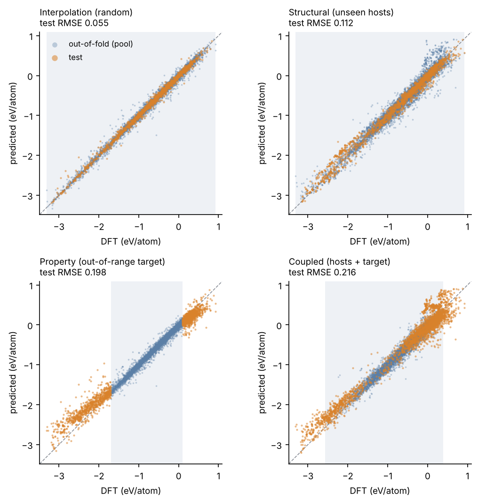

# dgtl：解耦式 GNN 迁移学习（外推型材料性质预测）

把预训练 GNN 冻结起来只当特征提取器，再接一个简单回归器（Ridge 或 SVR），用来预测训练分布之外的材料性质。这是对下面这篇论文方法的独立重写：

> T. Sugiura, T. Mizoguchi, *Achieving Robust Extrapolation in Materials Property Prediction via Decoupled Transfer Learning*, PRX Intelligence **1**, 023019 (2026). [doi:10.1103/pbrg-x848](https://doi.org/10.1103/pbrg-x848)

代码按论文描述从头写成，没有复制作者仓库的源文件。数据与预训练嵌入来自作者公开的发布（CC BY 4.0），用脚本下载，不随本仓库分发。

## 系统做什么

```
晶体结构 ──► 三个冻结的 OC20 预训练 GNN ──► 拼接成 2304 维向量 ──► MinMax 归一化 ──► Ridge / SVR ──► 性质
            CGCNN 512 · SchNet 1024 · DimeNet++ 768                     （只用非测试集统计量）
```

评测的重点在划分方式。先按部署场景划出测试集，剩下的再切验证折，调参永远看不到测试场景：

| 划分 | 含义 | 命令行名 |
|---|---|---|
| 内插 | 随机划分，基线 | `random` |
| 结构外推 | 整个宿主结构不进训练集 | `group` |
| 性质外推 | 目标值超出训练范围的样本做测试 | `target` |
| 耦合外推 | 含越界样本的宿主整组做测试 | `target_group` |
| 时间外推 | 用 MP18 训练，预测 MP21 新增材料 | `temporal` |
| 组成复杂度外推 | 用一元、二元训练，预测三元、四元 | `nelements` |

## 复现结果

完整表格和图见 [results/RESULTS.md](results/RESULTS.md)。主要数字（测试集 RMSE，eV/atom）：

**层状插层化合物（LIC，9024 个结构）**

| 场景 | 本仓库 SVR | 论文 SVR | 本仓库 Ridge | 论文端到端 CGCNN |
|---|---|---|---|---|
| 内插 | 0.055 | 0.055 | 0.081 | 0.063 |
| 结构外推 | 0.112 | 0.099 | 0.153 | 0.120 |
| 性质外推 | 0.198 | 0.205 | 0.190 | 0.378 |
| 耦合外推 | 0.216 | 0.199 | 0.624 | 0.308 |

**合金，时间划分（MP18 → MP21）**

| 模型 | 全部 | 训练范围内 | 训练范围外 | 论文（全部 / 内 / 外） |
|---|---|---|---|---|
| 3 GNN + SVR | 0.296 | 0.151 | 0.881 | 0.296 / 0.151 / 0.881 |
| 3 GNN + Ridge | 0.269 | 0.126 | 0.818 | 未报告 |
| Matminer + SVR | 0.702 | 0.240 | 2.262 | 0.702 / 0.240 / 2.262 |



合金数据集上的数字与论文逐位一致。LIC 的内插一致，另外三种场景相差 0.007 到 0.017 eV/atom，结论不变；差异最可能来自 SVR 求解器（论文用 GPU 上的 cuML，这里用 CPU 上的 libsvm）和分组折的具体分配。

### 论文之外，这套代码多回答的三个问题

1. **预测到底走出训练范围多远？** 报告里给每个实验加了“范围外斜率”：对真实值落在训练范围外的测试样本，预测值对真实值的回归斜率，1 表示趋势完整延续，0 表示预测趴平。合金上 SVR 的斜率是 0.66，Ridge 是 0.53，Matminer 特征只有 0.10。也就是说方法确实在外推，但对最不稳定的结构会系统性低估，这一点从论文图 4 能看出来，正文没有量化。
2. **简单的 Ridge 够不够？** 合金时间划分上 Ridge 的三项 RMSE 都略好于 SVR，LIC 性质外推上也是（0.190 对 0.198）。Ridge 只在结构发生变化的场景明显变差（耦合外推 0.624）。RBF 核的局部性是在换宿主时起稳定作用，这与论文的解释一致。
3. **能不能提前标出不可靠的预测？** 合金上“1 − 与训练集的最大 RBF 相似度”与绝对误差的 Pearson 相关为 0.82；LIC 结构外推上只有 0.24。这个诊断对性质外推有用，对换宿主的情形帮助有限。

## 安装与使用

```bash
pip install -e .                 # 回归部分：numpy、pandas、scipy、scikit-learn、matplotlib
bash scripts/fetch_data.sh       # 下载两张数据表和作者发布的嵌入，约 190 MB，放到 data/

python -m dgtl run --dataset lic --split target --lower -1.7 --upper 0.1 --regressor svr --plot parity.png
python -m dgtl run --dataset aoi --split temporal --regressor ridge
python -m dgtl suite main --jobs 4      # 论文主表，4 核约 20 分钟，可断点续跑
python -m dgtl suite full --jobs 4 --svr-grid medium   # 加上消融、核函数、阈值扫描、费米能
python -m dgtl report                   # 生成 results/RESULTS.md 和图
pytest                                  # 18 项测试
```

全程只需要 CPU。Ridge 的 201 个 α 值由一次特征分解得到整条正则化路径；SVR 每折只算一次核矩阵，网格里所有超参数复用。合金数据集的 Ridge 加 SVR 全流程约 80 秒。

### 用在自己的数据上

```bash
# 1. 从结构提取嵌入（需要 pip install -e ".[gnn]" 和 OC20 检查点）
python -m dgtl.extract.run --csv my.csv --structure-col cif --checkpoint-dir checkpoints --out work/emb

# 2. 回归；--group 指定用来做结构外推的分组列
python -m dgtl run --dataset custom --csv my.csv --target band_gap --group host \
    --embeddings work/emb/cgcnn.npy work/emb/schnet.npy work/emb/dimenetpp.npy \
    --split target_group --lower 0.5 --upper 3.0 --regressor svr
```

`--embeddings` 接受任意 `.npy` 特征块，所以也可以换成 MACE、CHGNet 等更新的基础模型的嵌入，回归和评测部分不用改。

## 代码结构

| 文件 | 内容 |
|---|---|
| `dgtl/data.py` | 读 LIC、AoI 和自定义数据集，按主键对齐嵌入 |
| `dgtl/splits.py` | 六种划分，分组场景下验证折同样按组切 |
| `dgtl/regressors.py` | Ridge 精确路径、预计算核 SVR（RBF、线性、多项式）、相似度局部 Ridge、MLP |
| `dgtl/pipeline.py` | 归一化、交叉验证选参、四折模型集成预测测试集、指标与可靠性诊断 |
| `dgtl/experiments.py` | 论文正文和补充材料里的全部实验配置，以及论文参考值 |
| `dgtl/report.py` | 结果表和对角图 |
| `dgtl/extract/` | 周期性近邻图、DimeNet 三元组、三个 GNN 的嵌入提取 |

## 已知的局限

- **嵌入提取模块还没有用真实权重验证过。** 三个网络的结构和参数命名按 OC20 检查点写成，形状、旋转不变性、超胞不变性的测试都通过，但写代码的环境访问不了检查点的下载地址，所以没有和作者发布的嵌入做过逐数值比对。上面的复现结果全部基于作者发布的嵌入。拿到 `cgcnn_all.pt`、`schnet_all_large.pt`、`dimenetpp_all.pt` 后，跑一遍 `dgtl.extract.run --dataset lic --max-rows 50` 与 `data/lic/embeddings/` 对比即可确认。
- 端到端微调的 CGCNN、DimeNet++ 基线需要 GPU 训练，这里没有重跑，表中直接引用论文数字。
- 论文没有给出费米能实验的阈值，`full` 套件里用的是目标值的分位数，数字不能与论文补充材料直接比较。
- 论文对 MLP 回归头用 softplus 激活，这里用 scikit-learn 的 ReLU 实现。
- 每个实验只跑了一个随机种子，和论文一样没有误差棒。

## 许可

代码 MIT。数据来源与第三方材料见 [NOTICE](NOTICE)。使用时请引用原论文以及 LIC、AoI、Open Catalyst Project 的数据来源。
