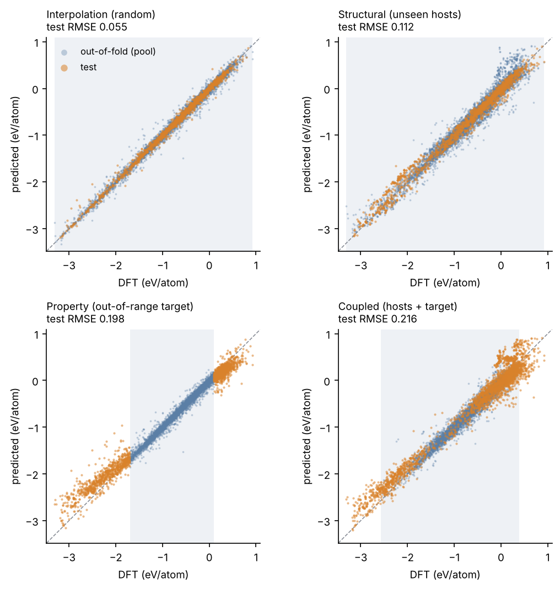
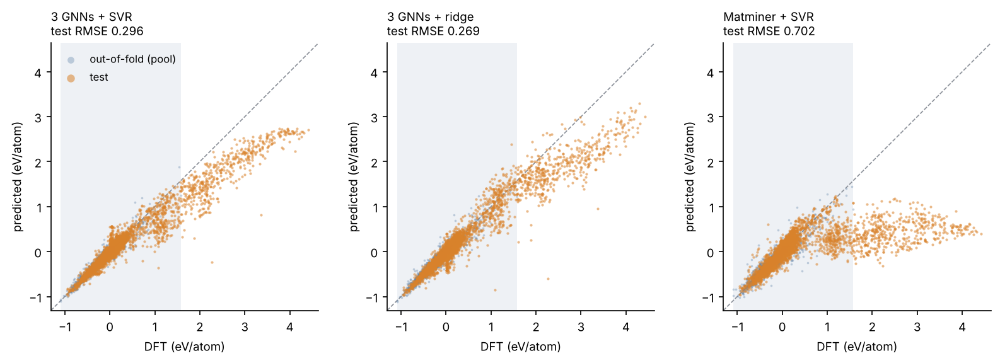

# Results

Generated by `python -m dgtl report`. Every number in the *this code* columns comes from the runs in `results/runs/`; *paper* columns are copied from Sugiura & Mizoguchi, PRX Intelligence 1, 023019 (2026). RMSE and MAE are in the target's unit (eV/atom for formation energy).

## Layered intercalation compounds: four scenarios

| Scenario | n test | SVR RMSE (this code) | SVR RMSE (paper) | Ridge RMSE (this code) | End-to-end CGCNN (paper) | SVR MAE | SVR R² |
|---|---|---|---|---|---|---|---|
| Interpolation (random) | 1804 | 0.055 | 0.055 | 0.081 | 0.063 | 0.035 | 0.995 |
| Structural (unseen hosts) | 1776 | 0.112 | 0.099 | 0.153 | 0.120 | 0.080 | 0.985 |
| Property (out-of-range target) | 2035 | 0.198 | 0.205 | 0.190 | 0.378 | 0.144 | 0.976 |
| Coupled (hosts + target) | 2688 | 0.216 | 0.199 | 0.624 | 0.308 | 0.166 | 0.960 |

Grey band: the range of target values seen in training. Points outside it are property extrapolation.

## Alloys, temporal split (train MP18, test MP21 additions)

*Inside* / *outside* split the test set at the top of the training range (1.575 eV/atom).

| Model | RMSE all | RMSE inside | RMSE outside | MAE | R² | paper: all / inside / outside |
|---|---|---|---|---|---|---|
| 3 GNNs + SVR | 0.296 | 0.151 | 0.881 | 0.143 | 0.873 | 0.296 / 0.151 / 0.881 |
| 3 GNNs + ridge | 0.269 | 0.126 | 0.818 | 0.130 | 0.895 | – |
| Matminer + SVR | 0.702 | 0.240 | 2.262 | 0.297 | 0.284 | 0.702 / 0.240 / 2.262 |
| Matminer + ridge | 0.928 | 0.368 | 2.928 | 0.425 | -0.252 | – |
| End-to-end CGCNN (paper, not re-run) | 0.876 | – | – | – | – | – |
| ALIGNN (paper, not re-run) | 0.747 | – | – | – | – | – |
| XGBoost (paper, not re-run) | 0.537 | – | – | – | – | – |
| Random forest (paper, not re-run) | 0.879 | – | – | – | – | – |
| Linear forest (paper, not re-run) | 0.606 | – | – | – | – | – |

## How far do predictions leave the training range?

RMSE alone hides whether a model extrapolates or just lands near the edge of what it saw. *Slope* is the least-squares slope of predicted against true value over the test rows whose true value lies outside the training range: 1.0 means the trend continues undamped, 0 means predictions are flat.

| Experiment | test rows outside range | predictions outside range | slope outside | RMSE inside | RMSE outside |
|---|---|---|---|---|---|
| `aoi/eform/temporal/ridge/all` | 9% | 7% | 0.53 | 0.126 | 0.818 |
| `aoi/eform/temporal/ridge/matminer` | 9% | 0% | 0.12 | 0.368 | 2.928 |
| `aoi/eform/temporal/svr/all` | 9% | 5% | 0.66 | 0.151 | 0.881 |
| `aoi/eform/temporal/svr/matminer` | 9% | 0% | 0.10 | 0.240 | 2.262 |
| `lic/eform/target/ridge/all` | 100% | 82% | 0.90 | – | 0.190 |
| `lic/eform/target/svr/all` | 100% | 83% | 0.89 | – | 0.198 |
| `lic/eform/target_group/ridge/all` | 15% | 18% | 1.01 | 0.620 | 0.651 |
| `lic/eform/target_group/svr/all` | 15% | 14% | 0.88 | 0.200 | 0.294 |

## Can unreliable predictions be flagged?

Correlation between a label-free diagnostic score and the absolute test error. SVR: 1 − max RBF similarity to any training point. Ridge: max |x_j w_j|.

| Experiment | Pearson | Spearman | mean score, inside | mean score, outside |
|---|---|---|---|---|
| `aoi/eform/temporal/ridge/all` | 0.73 | 0.36 | 1.108 | 2.194 |
| `aoi/eform/temporal/svr/all` | 0.82 | 0.57 | 0.051 | 0.310 |
| `lic/eform/group/ridge/all` | 0.08 | 0.07 | 0.186 | 0.217 |
| `lic/eform/group/svr/all` | 0.24 | 0.18 | 0.028 | 0.041 |
| `lic/eform/random/ridge/all` | 0.05 | 0.07 | 0.893 | – |
| `lic/eform/random/svr/all` | 0.49 | 0.33 | 0.017 | – |
| `lic/eform/target/ridge/all` | 0.13 | 0.19 | – | 1.356 |
| `lic/eform/target/svr/all` | 0.32 | 0.40 | – | 0.048 |
| `lic/eform/target_group/ridge/all` | 0.94 | 0.30 | 0.781 | 0.830 |
| `lic/eform/target_group/svr/all` | 0.47 | 0.43 | 0.090 | 0.102 |

## Selected hyperparameters

| Experiment | best | OOF RMSE | seconds |
|---|---|---|---|
| `aoi/eform/temporal/ridge/all` | `{"alpha": 0.05}` | 0.086 | 12 |
| `aoi/eform/temporal/ridge/matminer` | `{"alpha": 0.15000000000000002}` | 0.173 | 1 |
| `aoi/eform/temporal/svr/all` | `{"C": 100.0, "epsilon": 0.0}` | 0.076 | 71 |
| `aoi/eform/temporal/svr/matminer` | `{"C": 31.622776601683793, "epsilon": 0.02}` | 0.112 | 81 |
| `lic/eform/group/ridge/all` | `{"alpha": 10.0}` | 0.207 | 17 |
| `lic/eform/group/svr/all` | `{"C": 316.2277660168379, "epsilon": 0.02}` | 0.131 | 1000 |
| `lic/eform/random/ridge/all` | `{"alpha": 0.05}` | 0.089 | 17 |
| `lic/eform/random/svr/all` | `{"C": 100.0, "epsilon": 0.0}` | 0.063 | 1050 |
| `lic/eform/target/ridge/all` | `{"alpha": 0.05}` | 0.079 | 20 |
| `lic/eform/target/svr/all` | `{"C": 316.2277660168379, "epsilon": 0.0}` | 0.056 | 1110 |
| `lic/eform/target_group/ridge/all` | `{"alpha": 0.15000000000000002}` | 0.128 | 16 |
| `lic/eform/target_group/svr/all` | `{"C": 100.0, "epsilon": 0.0}` | 0.098 | 786 |
